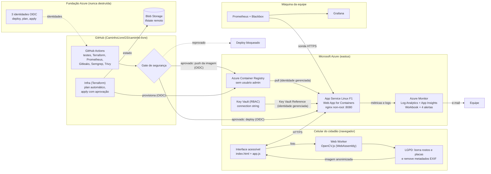

# Caminho Livre

[](https://github.com/CaminhoLivreGS/caminho-livre/actions/workflows/main.yml)

App colaborativo de acessibilidade urbana para pedestres com deficiência e mobilidade reduzida. O cidadão fotografa um problema na calçada, e um módulo de visão computacional no próprio celular confirma a evidência e borra rostos e placas antes de qualquer envio.

Trabalho da disciplina **Secure DevOps Tools & Cloud Computing**, FIAP.
**Integrantes:** Gilson Dias, Gabriel de Mendonça e Isabelle Toricelli.

📄 **Relatório completo da entrega (PDF):** [`docs/entrega/Caminho-Livre-Relatorio.pdf`](docs/entrega/Caminho-Livre-Relatorio.pdf), com diagrama, custos, LGPD, riscos aceitos e evidências.

## Ficha técnica do MVP

| Item | Descrição |
|---|---|
| **Nome do produto** | Caminho Livre |
| **Cidadão** | Pedestres com deficiência (visual, física, cadeirantes) e com mobilidade reduzida (idosos, gestantes, pessoas com carrinho de bebê), que dependem de calçadas transitáveis. |
| **Problema** | Buracos, calçadas quebradas, degraus, piso tátil interrompido, obstáculos e alagamentos impedem a circulação. As denúncias chegam ao poder público sem evidência confiável, duplicadas ou com fotos que expõem pessoas e placas de veículos. |
| **Proposta de valor** | Denunciar um problema em 4 passos (Foto, Tipo, Resultado, Enviado), com interface acessível (WCAG 2.1, teclado e leitor de tela). A visão computacional confirma a evidência e anonimiza a foto no próprio aparelho, gerando denúncias verificadas e em conformidade com a LGPD. |
| **Arquitetura** | SPA (Vite + JavaScript) com OpenCV.js em Web Worker, servida por nginx non-root em container. Azure App Service (Web App for Containers) + Azure Container Registry, provisionados por Terraform, com pipeline DevSecOps no GitHub Actions e observabilidade no Azure Monitor e em Prometheus/Grafana. Ver [Arquitetura](#arquitetura). |
| **Fontes de dados** | Fotos enviadas pelo cidadão (processadas só no aparelho). Calibração e testes com 101 fotos de licença livre do [Wikimedia Commons](dataset/CREDITOS.md), sem pessoas identificáveis. Estrutura pronta para um dataset brasileiro de treino/teste (`dataset/brasil/`). |
| **Modelos de IA** | Visão computacional clássica: Canny, morfologia, limiarização HSV, componentes conexos, Hough e hash perceptual (dHash). Única IA treinada: **Haar Cascades** do OpenCV 4.9.0 (rosto frontal, perfil e placa), usada só para anonimização. Placas brasileiras detectadas por agrupamento de caracteres. Detalhes em [`docs/visao-computacional.md`](docs/visao-computacional.md). |
| **URL** | https://app-caminholivre-prod-00e44e.azurewebsites.net. Disponível durante o período de avaliação; ver [Status do ambiente](#status-do-ambiente). |
| **Indicadores de impacto** | **Medidos hoje:** acurácia de 65,7% (Acessibilidade), 89,7% (Obstáculo) e 87,0% (Alagamento); 17 de 21 placas brasileiras borradas; 0 fotos reais rejeitadas indevidamente. **Metas para o piloto:** número de denúncias validadas por mês; % confirmadas automaticamente (sem moderação); tempo médio até o encaminhamento à prefeitura; 100% das fotos enviadas anonimizadas; disponibilidade ≥ 99% e latência p95 < 2 s. |
| **ODS** | **ODS 10, Redução das desigualdades** (meta 10.2: inclusão de pessoas com deficiência). **ODS 11, Cidades e comunidades sustentáveis** (meta 11.2: transporte e mobilidade acessíveis; meta 11.7: espaços públicos seguros, inclusivos e acessíveis). |

## Status do ambiente

| | |
|---|---|
| **URL** | https://app-caminholivre-prod-00e44e.azurewebsites.net |
| **Situação** | 🟢 **No ar para a avaliação** desde 16/11/2026 |
| **Plano** | App Service F1 (gratuito). A primeira visita após um período sem acesso pode levar até ~1 minuto, enquanto o container inicia (*cold start*); as seguintes são imediatas. |
| **Custo enquanto no ar** | ≈ US$ 0,17/dia (só o Container Registry tem custo fixo) |

Fora do período de avaliação, a infraestrutura é desligada para poupar créditos e a URL deixa de responder. Para religar ou desligar, sem acesso ao portal do Azure:

1. GitHub → **Actions** → **Infra (Terraform)** → **Run workflow** (branch `main`).
2. Escolha `acao = apply` (liga) ou `acao = destroy` (desliga).
3. Um revisor aprova a execução no environment `infra`. O `apply` cria os recursos e dispara o deploy da aplicação, em cerca de 15 minutos.

## Arquitetura



**Fluxo:**
1. Todo push dispara o pipeline. Os testes e os scanners de segurança rodam em paralelo.
2. Se qualquer verificação falhar, o gate reprova e o deploy não acontece.
3. Na `main`, a imagem aprovada (a mesma que o Trivy analisou) vai para o ACR com a tag do commit, e o Web App é atualizado. O login no Azure é feito por OIDC, sem senha guardada.
4. A foto do cidadão é analisada e anonimizada no navegador. O servidor só entrega arquivos estáticos.

## Pilar 1: container e infraestrutura como código

**Container** ([`Dockerfile`](Dockerfile)):
- Build multi-stage: Node só para compilar; o runtime é `nginx-unprivileged` com o bundle estático.
- **Usuário non-root** (UID 101), porta 8080. O pipeline falha se a imagem rodar como root.
- Sem segredos na imagem: não há credenciais em `ARG`/`ENV`, e o [`.dockerignore`](.dockerignore) exclui `.env`, `*.tfvars` e `*.tfstate`.
- Dependências binárias (Haar Cascades) baixadas com verificação de SHA-256.
- Headers de segurança no nginx: CSP sem `unsafe-inline`, HSTS, `X-Frame-Options`, `Permissions-Policy` limitando a câmera à própria origem.

**Docker Compose** ([`docker-compose.yml`](docker-compose.yml)):
- `docker compose up --build -d` sobe o app. Com `--profile observability`, sobe também Prometheus, Blackbox, nginx-exporter e Grafana.
- Portas publicadas só em `127.0.0.1`, sistema de arquivos read-only, `cap_drop: ALL`, `no-new-privileges` e limites de CPU e memória.
- A senha do Grafana é um Docker secret, num arquivo fora do git.

**Terraform** ([`infra/terraform/`](infra/terraform/)):

| Recurso | Configuração de segurança |
|---|---|
| Azure Container Registry (Basic) | Sem usuário admin e sem pull anônimo; acesso só por RBAC |
| App Service Plan Linux (F1) + Web App for Containers | HTTPS obrigatório, TLS 1.2+, FTP e WebDeploy com senha desligados, health check em `/healthz` |
| Identidade gerenciada do Web App | Papel `AcrPull` no ACR (sem senha de registry) |
| **Key Vault** (standard) | Autorização só por RBAC. Guarda a connection string do Application Insights, que o Web App lê por *Key Vault Reference* com a identidade gerenciada. O segredo é gravado como **write-only** (`value_wo`), então o recurso do segredo não guarda o valor no tfstate. A mesma connection string ainda aparece no estado como atributo do próprio Application Insights, por isso o tfstate é protegido: só Entra ID, sem chaves, acesso por RBAC |
| Papéis da identidade de deploy | `AcrPush` e `Reader` no ACR e `Website Contributor` no Web App |
| Log Analytics + Application Insights | Retenção de 30 dias, teto de 0,1 GB/dia, IP mascarado |
| Alertas e Workbook | Ver [Pilar 3](#pilar-3-observabilidade) |
| Budget da assinatura | US$ 10/mês, alertas em 50%, 80% e 100% do gasto real e 100% do previsto |

**Regras exigidas:**
- **`tfstate` e `.tfvars` fora do repositório:** o estado fica num Azure Blob Storage criado por [`infra/bootstrap/fundacao.sh`](infra/bootstrap/fundacao.sh). Esse Storage tem autenticação só por Entra ID (chaves desligadas), versionamento e soft delete de 14 dias. `backend.hcl`, `terraform.tfvars` e `*.tfstate` estão no [`.gitignore`](.gitignore); o repositório só tem o modelo `terraform.tfvars.example`.
- **Portas de administração nunca abertas para `0.0.0.0/0`:** o App Service só expõe 80/443, e o HTTP é redirecionado para HTTPS. O site de administração (SCM/Kudu, por onde passa o SSH) é **negado para todos por padrão**. A variável `admin_cidrs` libera IPs específicos e sua validação **rejeita qualquer faixa maior que /16**, incluindo `0.0.0.0/0`.

**Fundação** ([`infra/bootstrap/fundacao.sh`](infra/bootstrap/fundacao.sh), executada uma vez por um Owner): o tfstate e as 3 identidades do GitHub ficam num resource group que nunca é destruído. Se ficassem no Terraform principal, o `destroy` apagaria a identidade que o CI usa para recriar a infra.

| Identidade | Environment do GitHub | Permissões |
|---|---|---|
| deploy | `production` (só a `main`) | `AcrPush`/`Reader` no ACR e `Website Contributor` no Web App (concedidas pelo Terraform) |
| plan | `infra-plan` | `Reader` na assinatura, leitura do tfstate e `Key Vault Secrets User` (para o refresh) |
| apply | `infra` (só a `main` + **aprovação de um revisor**) | `Contributor` + administração de RBAC **limitada por condição ABAC** aos 6 papéis que o Terraform atribui; não consegue conceder Owner nem Contributor |

As credenciais federadas usam os IDs imutáveis do repositório (`repo:CaminhoLivreGS@355958631/caminho-livre@1456200921:environment:...`), então um repositório recriado com o mesmo nome não herda o acesso. Locks `CanNotDelete` (resource group) e `ReadOnly` (identidades) impedem que a identidade de apply apague o tfstate ou adicione credenciais federadas para outro repositório. Contributor não remove locks; o teste com Owner retornou `ScopeLocked`.

```sh
az login && sh infra/bootstrap/fundacao.sh                             # uma vez: fundação
EMAIL_ALERTA=voce@exemplo.com sh infra/scripts/configurar-github.sh    # environments, secrets e variables
# Depois: Actions > Infra (Terraform) > Run workflow > acao=apply
```

## Pilar 2: pipeline DevSecOps

Dois workflows:
- [`main.yml`](.github/workflows/main.yml) (CI/CD DevSecOps): roda em todo push (qualquer branch), em PR para a `main` e manualmente.
- [`infra.yml`](.github/workflows/infra.yml) (Infra Terraform): `terraform plan` automático em PRs e pushes que mexam em `infra/terraform/`; `apply` e `destroy` só por disparo manual na `main`, com aprovação.

| Job | O que faz | Bloqueia quando |
|---|---|---|
| Testes e build | 23 testes unitários do núcleo de visão + build de produção | Algum teste falha |
| Terraform | `fmt -check` e `validate` | Formatação ou sintaxe inválida |
| Observabilidade | `promtool check` e testes unitários das regras de alerta | Config ou regra inválida |
| **Gitleaks** | Varre segredos em **todo o histórico** git | Encontra qualquer segredo |
| **Semgrep** | SAST com regras de JavaScript, React, segredos, Dockerfile, nginx e Terraform | Achado de risco **ALTO ou CRÍTICO** (matriz de risco OWASP: probabilidade × impacto, em [`.github/scripts/semgrep_gate.py`](.github/scripts/semgrep_gate.py)) |
| **Trivy** | CVEs da imagem Docker, segredos na imagem, misconfigurações de Dockerfile e Terraform, usuário non-root | CVE **HIGH ou CRITICAL** com correção disponível, ou misconfiguração HIGH/CRITICAL |
| Gate de segurança | Consolida os resultados acima | Qualquer job anterior falhou |
| Deploy (Azure) | Localiza o ACR e o Web App pela tag do projeto, envia a imagem aprovada e atualiza o Web App, com smoke test em `/healthz` | Só roda na `main` com o gate aprovado; com a infra desligada, registra e termina |
| Terraform plan (`infra.yml`) | Plano com a identidade de leitura; o resumo mostra só os endereços dos recursos | Configuração inválida ou erro no plano |
| Terraform apply/destroy (`infra.yml`) | Plano e aplicação com a identidade de apply; o `apply` dispara o deploy | Exige aprovação no environment `infra` |

**Controles do pipeline:**
- Credenciais no **GitHub Secrets**: `AZURE_TENANT_ID`, `AZURE_SUBSCRIPTION_ID` e `ALERT_EMAIL` no repositório, e `AZURE_CLIENT_ID` em cada environment (uma identidade por função). São só identificadores: o login usa OIDC, sem senha de longa duração para vazar. Os valores são mascarados nos logs, e o arquivo de plan não é publicado como artefato.
- Todas as Actions de terceiros fixadas por SHA de commit e `permissions` mínimas por job.
- A branch `main` é protegida: exige PR e o check "Gate de segurança"; force push e exclusão bloqueados, valendo também para admins.
- Os environments `production` e `infra` só aceitam a `main`, e `infra` exige aprovação de um revisor.
- Relatórios SARIF publicados no GitHub Code Scanning (aba Security) e como artefatos por 30 dias.
- Riscos aceitos documentados em [`.trivyignore`](.trivyignore), com justificativa e controles compensatórios: o app é público (sem login nem certificado de cliente), e o firewall do Key Vault fica aberto porque o plano F1 não tem VNet e os runners do GitHub não têm IP fixo.

### Simulação de falha (evidência do bloqueio)

1. Criar a branch `simulacao/falha-seguranca`.
2. Adicionar um arquivo JavaScript com uma connection string falsa do Azure Storage (Gitleaks) e um `res.send()` com entrada do usuário mais um segredo JWT fixo no código (Semgrep, 2 achados ALTO).
3. No `Dockerfile` da mesma branch, voltar o runtime para `nginxinc/nginx-unprivileged:1.27-alpine` e remover o `apk upgrade` (Trivy: 68 CVEs HIGH/CRITICAL).
4. Abrir PR para a `main`: os três scanners reprovam, o gate mostra **DEPLOY BLOQUEADO** e o merge fica travado.
5. Fechar o PR sem mesclar e apagar a branch. Assim o segredo falso nunca entra na `main`.

## Pilar 3: observabilidade

As **4 Métricas de Ouro** (Google SRE) são monitoradas em duas camadas:

| Sinal | Azure Monitor (métrica do Web App) | Prometheus local |
|---|---|---|
| **Latência** | `HttpResponseTime` (média) e p50/p95/p99 dos logs HTTP | `probe_duration_seconds` (sonda externa, com as fases DNS/TCP/TLS/servidor) |
| **Tráfego** | `Requests` | `nginx_http_requests_total` (req/s) |
| **Erros** | `Http5xx`, `Http4xx`, `HealthCheckStatus` | `probe_success`, `probe_http_status_code` |
| **Saturação** | `CpuTime` (métrica indicada para o plano F1) e `MemoryWorkingSet` | `nginx_connections_active` |

**Azure Monitor** ([`infra/terraform/observabilidade.tf`](infra/terraform/observabilidade.tf)): um Workbook "Caminho Livre - Métricas de Ouro" no portal e 4 regras de alerta que enviam e-mail para a equipe:

| Alerta | Condição | Severidade |
|---|---|---|
| Erros 5xx | Mais de 5 respostas 5xx em 5 minutos | 1 |
| Latência | Tempo médio de resposta acima de 2 s em 5 minutos | 2 |
| Saturação de CPU | Mais de 60 s de CPU em 15 minutos | 2 |
| Disponibilidade | Health check abaixo de 100% em 5 minutos | 1 |

**Prometheus + Grafana local** ([`observability/`](observability/)):
- O Blackbox Exporter sonda a URL pública do Azure e o container local.
- O dashboard do Grafana já vem configurado ao subir a stack.
- 7 regras de alerta em [`regras/alertas.yml`](observability/prometheus/regras/alertas.yml): indisponibilidade, 5xx, latência, saturação de conexões, pico de tráfego, certificado TLS expirando e coletor fora do ar. Todas com testes unitários no CI.

```sh
openssl rand -base64 24 > observability/grafana/admin-password   # senha do Grafana (fora do git)
sh infra/scripts/configurar-observabilidade.sh                  # aponta as sondas para a URL do Azure
docker compose --profile observability up --build -d
# Grafana: http://127.0.0.1:3000 | Prometheus/alertas: http://127.0.0.1:9090/alerts
```

**Evidência:** em uma queda simulada (container parado), o alerta `AplicacaoIndisponivel` passou de *pending* para *firing* em 2 minutos, e o dashboard registrou a queda: [`docs/evidencias/grafana-metricas-de-ouro-queda-simulada.png`](docs/evidencias/grafana-metricas-de-ouro-queda-simulada.png).

Como a visão computacional roda no celular do cidadão, a CPU do container é usada só para servir arquivos estáticos. Por isso, os alertas principais são de erros e latência, e o de CPU (`CpuTime`) protege a cota de 60 minutos de CPU por dia do plano F1.

## Estimativa de custos (Azure)

Preços de tabela em USD, região `eastus`, consultados em [prices.azure.com](https://prices.azure.com/api/retail/prices) em 13/11/2026. A assinatura Azure for Students só permite as regiões `eastus`, `southcentralus`, `canadacentral`, `mexicocentral` e `southafricanorth`.

| Recurso | SKU | Preço unitário | Custo/mês (MVP) |
|---|---|---|---|
| App Service Plan Linux | **F1 (Free)** | US$ 0 | **US$ 0,00** |
| Azure Container Registry | Basic (10 GB inclusos) | US$ 0,1666/dia | **US$ 5,00** |
| Log Analytics | Pay-as-you-go | 5 GB/mês grátis; depois US$ 2,30/GB | **US$ 0,00** (teto de 0,1 GB/dia ≈ 3 GB/mês) |
| Application Insights + Workbook | Baseado em workspace | Incluso no Log Analytics | **US$ 0,00** |
| Alertas de métrica (4 regras) | | 10 primeiras grátis; depois US$ 0,10/mês | **US$ 0,00** |
| Action group (e-mail) | | 1.000 e-mails/mês grátis | **US$ 0,00** |
| Storage do tfstate | Standard LRS | Poucos KB | **< US$ 0,01** |
| Key Vault | Standard | Sem mensalidade; US$ 0,03 a cada 10 mil operações | **≈ US$ 0,00** |
| Identidades, RBAC, locks, budget | | Sem custo | **US$ 0,00** |
| **Total** | | | **≈ US$ 5,00/mês (≈ US$ 0,17/dia)** |

**Cenário de produção (referência):** App Service B1 (US$ 0,017/h ≈ US$ 12,41/mês), que adiciona Always On, sem cold start e com SLA, totalizando **≈ US$ 17,40/mês**.

**Estratégia de economia:**
- F1 gratuito no MVP.
- Teto diário de ingestão de logs.
- Budget com alertas por e-mail.
- Infra desligada fora das janelas de avaliação com [`infra/scripts/destruir.sh`](infra/scripts/destruir.sh); o ACR é o único custo fixo. Na sessão de validação (cerca de 2 h no ar, com deploy, simulação de falha e alerta), o gasto ficou em torno de US$ 0,01.
- [`infra/scripts/custos.sh`](infra/scripts/custos.sh) mostra o gasto real do mês por recurso (Cost Management).

## Modelo de responsabilidade compartilhada

O Azure App Service é um serviço **PaaS**: a Microsoft opera a plataforma e a equipe responde pelo que roda nela e por como ela é configurada.

| Camada | Microsoft (provedor) | Equipe Caminho Livre (cliente) | Como fazemos |
|---|---|---|---|
| Datacenter, hardware e rede física | ✅ | | |
| Sistema operacional do host e virtualização | ✅ | | |
| Runtime do App Service, balanceador, patches da plataforma | ✅ | | |
| Certificado TLS do domínio `*.azurewebsites.net` | ✅ | | |
| **Imagem do container** (SO base, pacotes, nginx) | | ✅ | Trivy bloqueia CVEs HIGH/CRITICAL; `apk upgrade` no build; base Alpine atualizada |
| **Código da aplicação** | | ✅ | Semgrep (SAST), testes unitários, revisão por PR |
| **Segredos e credenciais** | Fornece o Key Vault (armazenamento criptografado, disponibilidade, controle de acesso) | ✅ | Arquitetura sem segredos de longa duração (OIDC, identidade gerenciada, ACR sem admin); Key Vault por RBAC com segredo write-only; tfstate só com Entra ID; Gitleaks no histórico; GitHub Secrets |
| **Identidade e acesso** (RBAC) | Fornece o Entra ID e o RBAC | ✅ Configura | Menor privilégio: `AcrPull`, `AcrPush`, `Website Contributor` restritos ao recurso |
| **Configuração de rede e exposição** | Fornece os controles | ✅ Configura | HTTPS obrigatório, TLS 1.2, SCM/SSH negado por padrão, sem `0.0.0.0/0` |
| **Dados e privacidade (LGPD)** | Protege a infraestrutura onde os dados ficam | ✅ | Anonimização no aparelho, IP mascarado no App Insights, retenção limitada |
| **Monitoramento e resposta** | Fornece o Azure Monitor | ✅ Configura e responde | Métricas de Ouro, 4 alertas por e-mail, budget |
| **Estado da infraestrutura** | Durabilidade do Blob Storage | ✅ | tfstate remoto, sem chaves, versionado, fora do git |

Se o produto migrasse para IaaS (máquinas virtuais), o patch do sistema operacional, o firewall do host e o SSH passariam a ser responsabilidade da equipe. Por isso o PaaS foi escolhido para o MVP.

## Estratégia de LGPD

**Princípios aplicados (art. 6º):** finalidade, necessidade (minimização), segurança e prevenção.

1. **Anonimização antes de sair do aparelho.** A foto é processada no navegador do cidadão, num Web Worker com OpenCV.js. Rostos (frontal e perfil) e placas de veículos são detectados e **borrados**, e o cidadão pode borrar áreas extras manualmente. Só a imagem já anonimizada pode ser enviada.
2. **Sem metadados.** O envio usa o canvas re-renderizado, então os dados EXIF (GPS do aparelho, modelo da câmera, data) são descartados.
3. **Nenhuma foto no servidor, no MVP.** O backend de denúncias ainda não existe (`ENDPOINT_DENUNCIAS = null` em `app/app.js`), e o app roda em modo demonstração: **nada sai do aparelho**. O container no Azure só entrega arquivos estáticos e não recebe uploads (`client_max_body_size 1m`).
4. **Trânsito protegido.** HTTPS obrigatório com TLS 1.2+ e HSTS. A CSP `connect-src 'self'` impede que o código envie dados para outros domínios.
5. **Telemetria mínima.** Não há cookies de rastreamento nem SDK de analytics no front-end, e o Application Insights mascara o IP. Os logs HTTP do App Service (URL, status, IP de origem e user agent) servem só para segurança e operação (legítimo interesse, art. 7º, IX), com retenção de 30 dias no Log Analytics e 3 dias no sistema de arquivos.
6. **Dataset sem pessoas.** O repositório é público, então todas as fotos com pessoas identificáveis foram retiradas do dataset de testes, mesmo tendo licença livre.
7. **Região de dados.** A política da assinatura acadêmica não permite `brazilsouth`, por isso a infraestrutura fica em `eastus`. Como as fotos não vão para a nuvem, só os logs operacionais acima ficam fora do Brasil, sob as cláusulas contratuais de proteção de dados da Microsoft (art. 33). Em produção, a recomendação é migrar para `brazilsouth`.

**Próximos passos para o backend:** autenticação do cidadão, limite de envios, deduplicação pelo hash perceptual, fila de moderação para casos `INCONCLUSIVO`, criptografia em repouso das imagens já anonimizadas, política de retenção e canal para os direitos do titular (art. 18).

## Evidências para a avaliação

Galeria completa, com a descrição de cada print: [`docs/evidencias/`](docs/evidencias/README.md).

| Requisito | Evidência |
|---|---|
| Pipeline aprovado, com os 3 scanners em paralelo e **deploy automático no Azure** | [Run com deploy](https://github.com/CaminhoLivreGS/caminho-livre/actions/runs/43898004965) ([print](docs/evidencias/06-run-verde-com-deploy.png)): 8 jobs verdes, login OIDC, push no ACR, deploy no Web App e smoke test em `/healthz`. [App no ar](docs/evidencias/07-app-no-ar-azure.png) |
| **Bloqueio automático** por vulnerabilidade | [PR #3, simulação de falha](https://github.com/CaminhoLivreGS/caminho-livre/pull/3), fechado sem merge. Gitleaks detecta o segredo falso ([print](docs/evidencias/01-pr3-gitleaks-segredo.png)); Semgrep aponta 2 achados ALTO, XSS e JWT fixo ([print](docs/evidencias/02-pr3-semgrep-xss.png), [print](docs/evidencias/03-pr3-semgrep-jwt-sem-deploy.png)); Trivy encontra **68 CVEs, 65 HIGH e 3 CRITICAL** ([print](docs/evidencias/05-trivy-68-cves.png)); o gate mostra "DEPLOY BLOQUEADO" ([print](docs/evidencias/04-gate-deploy-bloqueado.png)) e a proteção da `main` impede o merge. [Logs completos](docs/evidencias/logs-run-simulacao-43903627055.zip) |
| Relatórios dos scanners | Aba Security → Code scanning e artefatos de cada execução |
| Container non-root | Passo "Verificar usuário non-root" no job do Trivy (UID 101) |
| Infraestrutura por pipeline, com aprovação | [Apply aprovado no environment `infra`](https://github.com/CaminhoLivreGS/caminho-livre/actions/runs/43956593526) ([print](docs/evidencias/15-infra-apply-aprovado.png)). O `terraform plan` roda automaticamente em PRs com a identidade de leitura |
| tfstate remoto e `.tfvars` fora do git | Backend `azurerm` em [`infra/terraform/versions.tf`](infra/terraform/versions.tf); `*.tfstate`, `*.tfvars` e `backend.hcl` no [`.gitignore`](.gitignore) |
| SSH/administração fechada | Verificado com a infra no ar: o SCM/Kudu respondeu **HTTP 403** a acessos pela internet (`scm_ip_restriction_default_action = "Deny"`; `admin_cidrs` rejeita `0.0.0.0/0`) |
| Métricas de Ouro e alerta disparado | Azure Monitor: o alerta `disponibilidade` (Sev1) disparou enquanto o app respondia 503 e se resolveu sozinho após o deploy ([lista](docs/evidencias/08-azure-monitor-alertas.png), [detalhe](docs/evidencias/09-azure-alerta-disponibilidade.png)). Prometheus local: queda simulada com alerta em 2 minutos ([print](docs/evidencias/grafana-metricas-de-ouro-queda-simulada.png)) |

**Ligar ou desligar a infraestrutura:** ver [Status do ambiente](#status-do-ambiente). Alternativa local de emergência para desligar: `sh infra/scripts/destruir.sh`.

## Estrutura do repositório

```
.github/workflows/main.yml     pipeline DevSecOps
.github/scripts/               gate de risco do Semgrep
Dockerfile, .dockerignore      imagem non-root
docker/nginx/                  configuração e headers de segurança do nginx
docker-compose.yml             stack local (app + observabilidade)
infra/bootstrap/               criação do backend remoto do tfstate
infra/terraform/               ACR, Web App, OIDC, observabilidade, alertas, budget
infra/scripts/                 cadastro de secrets no GitHub, sondas e custos
observability/                 Prometheus, Blackbox, regras de alerta e Grafana
docs/                          visão computacional e evidências
app/, src/, index.html         aplicação (interface + visão computacional)
dataset/, scripts/, test/      dataset de avaliação, utilitários e testes
```

## Créditos

As fotos do dataset são do Wikimedia Commons, cada uma com sua licença original; autores e links em [`dataset/CREDITOS.md`](dataset/CREDITOS.md). O OpenCV é distribuído sob a licença Apache 2.0. Os Haar Cascades de rosto trazem a Intel License Agreement no cabeçalho de cada XML (licença permissiva, exige manter o aviso); eles são baixados sem alteração por `npm run deps`.
