# Evidências da entrega

Sessão de validação no Azure em 16/11/2026: infraestrutura criada com `terraform apply`, deploy automático pelo pipeline, simulação de falha de segurança e alerta do Azure Monitor. Depois disso, a infraestrutura foi destruída para poupar créditos (gasto da sessão ≈ US$ 0,01).

## 1. Bloqueio automático por vulnerabilidade (Pilar 2)

[PR #3, simulação de falha](https://github.com/CaminhoLivreGS/caminho-livre/pull/3), fechado sem merge. Os segredos do PR são falsos e foram criados para o teste.

**Gitleaks** detecta a connection string do Azure Storage escrita no código:

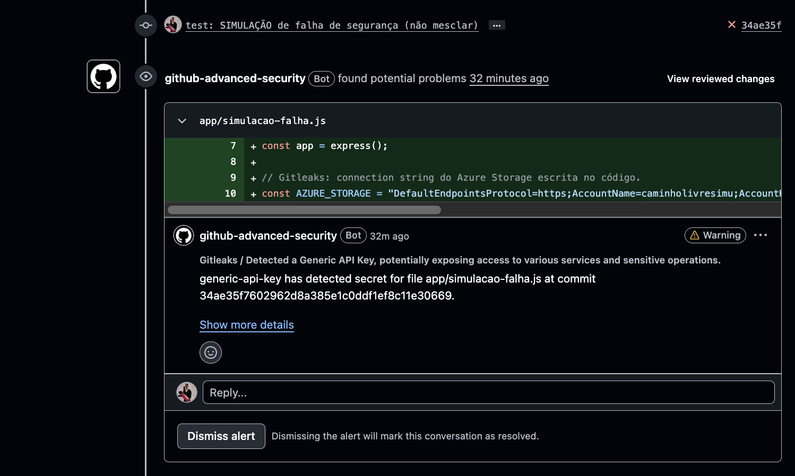

**Semgrep** aponta XSS (`res.send` com entrada do usuário). O gate classifica `raw-html-format` como risco ALTO, que bloqueia, e `direct-response-write` como MÉDIO, que é só registrado:

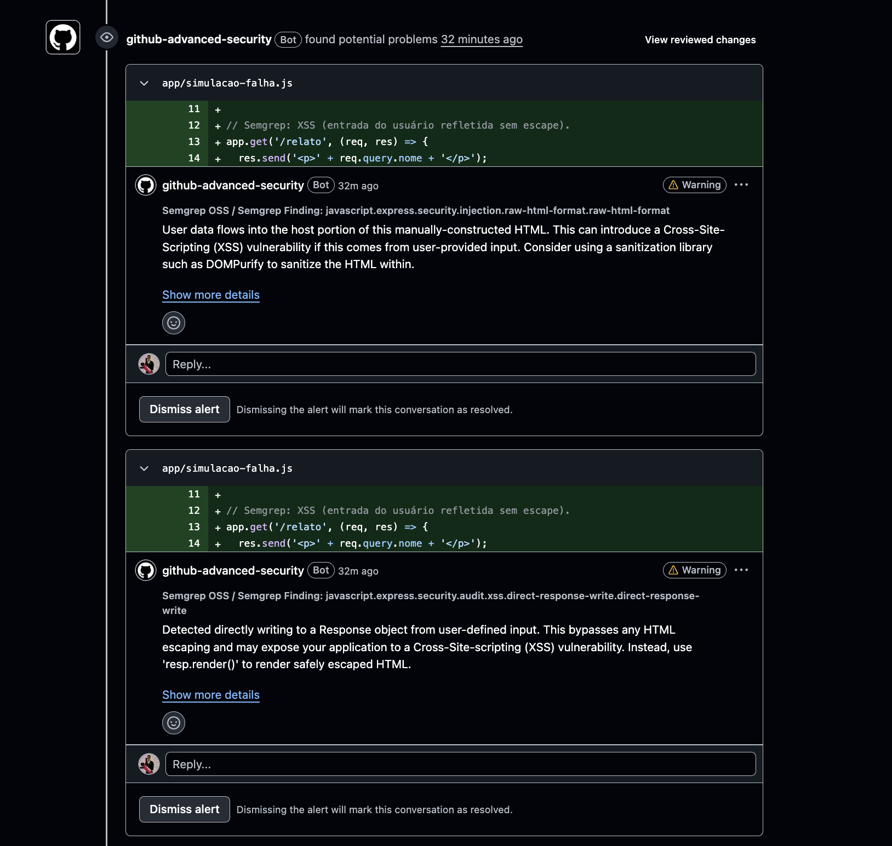

**Semgrep** aponta segredo de JWT fixo no código (risco ALTO). O PR termina com "This branch has not been deployed":

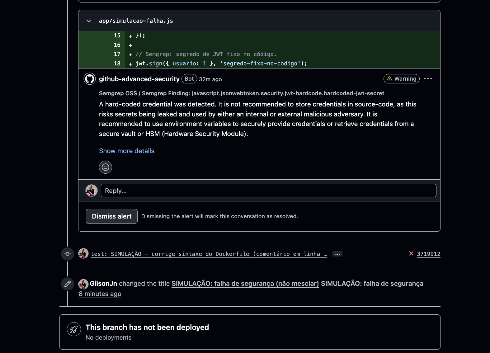

**Gate de segurança** consolida o resultado e bloqueia o deploy:

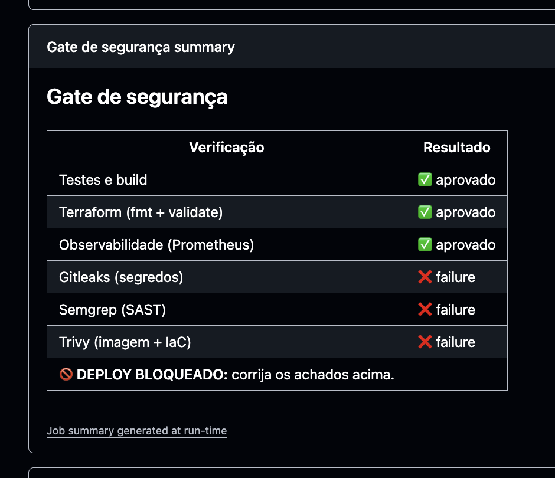

**Trivy** encontra 68 vulnerabilidades HIGH/CRITICAL (65 HIGH, 3 CRITICAL) na imagem com base antiga (Alpine 3.21.3) e sem `apk upgrade`:

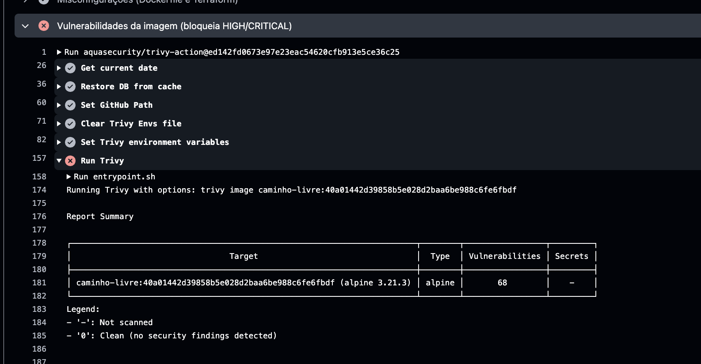

Logs completos dessa execução, guardados porque o GitHub apaga logs de Actions após 90 dias: [`logs-run-simulacao-43903627055.zip`](logs-run-simulacao-43903627055.zip) ([run original](https://github.com/CaminhoLivreGS/caminho-livre/actions/runs/43903627055)).

## 2. Pipeline aprovado com deploy automático no Azure (Pilares 1 e 2)

[Run #18](https://github.com/CaminhoLivreGS/caminho-livre/actions/runs/43898004965): os 6 jobs de verificação passam em paralelo, o gate aprova e o deploy publica no Azure Web App (login OIDC, push no ACR e smoke test em `/healthz`):

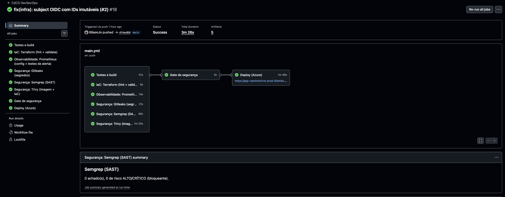

Infraestrutura criada pelo workflow *Infra (Terraform)*: o `apply` só rodou depois da aprovação manual no environment `infra` e disparou o deploy da aplicação:

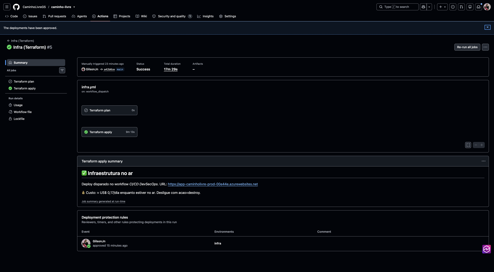

Aplicação no ar em `https://app-caminholivre-prod-00e44e.azurewebsites.net`:

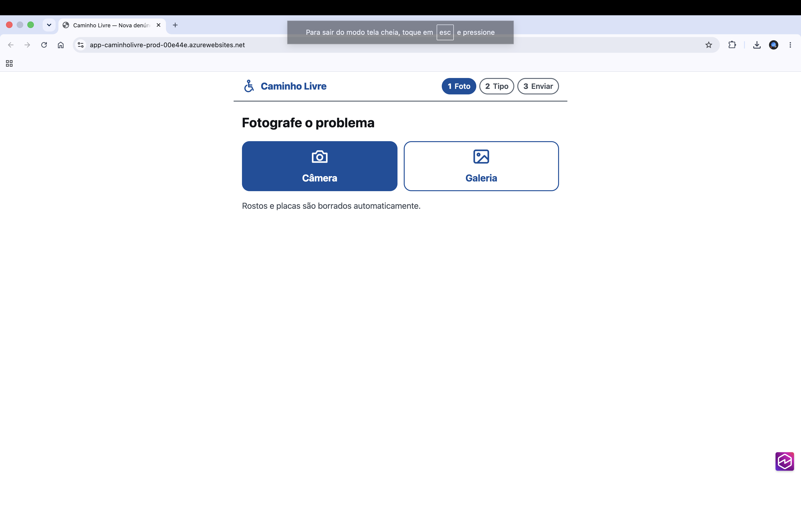

## 3. Alerta do Azure Monitor (Pilar 3)

O alerta `alerta-caminholivre-prod-disponibilidade` (severidade 1) disparou às 12:35 (UTC-3), enquanto o app ainda respondia 503 antes do primeiro deploy. Ele se resolveu sozinho depois do deploy:

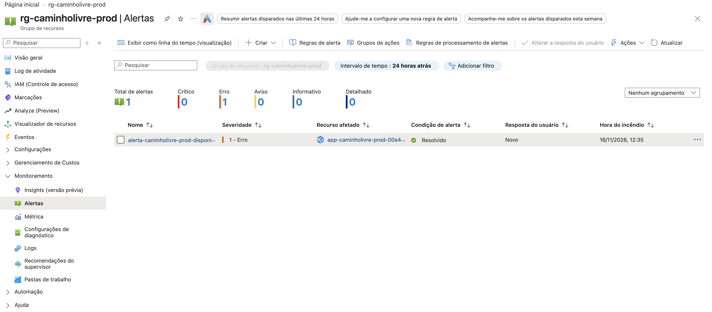

O gráfico mostra o `HealthCheckStatus` caindo de 100 para 0 e voltando ao normal:

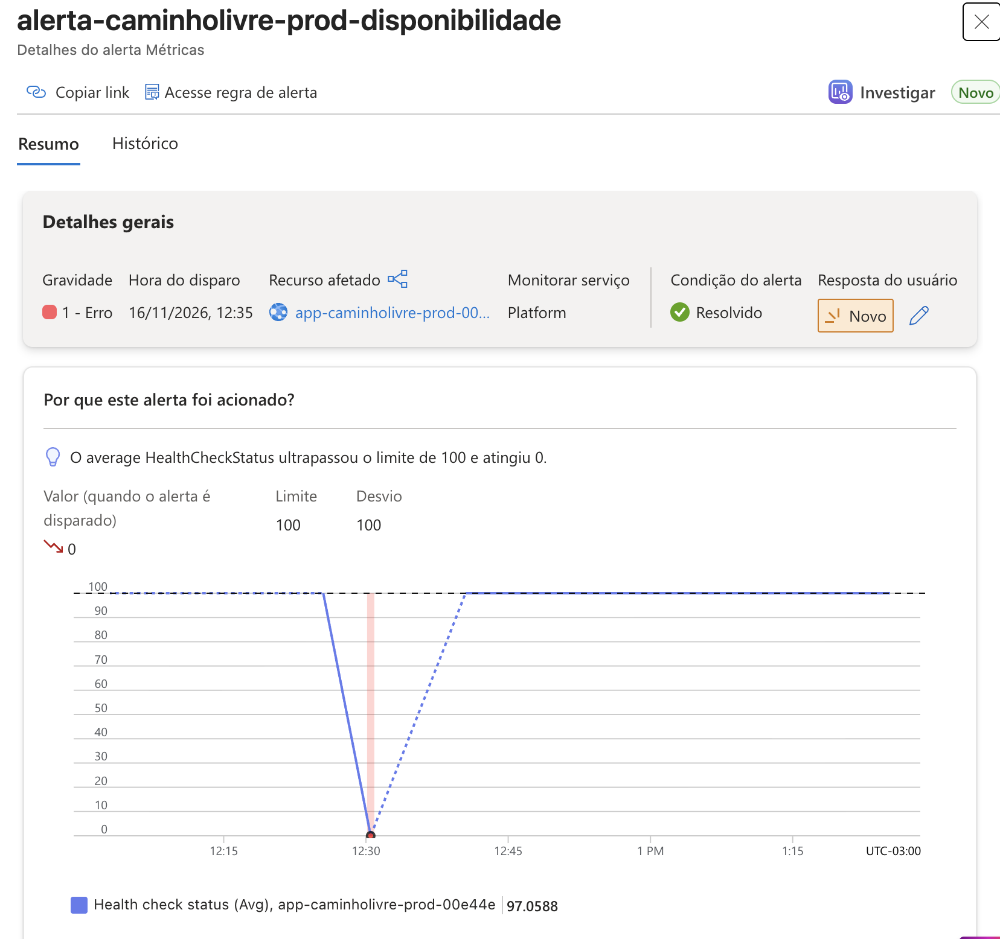

Na stack local (Prometheus + Grafana), uma queda simulada disparou o alerta `AplicacaoIndisponivel` em 2 minutos:

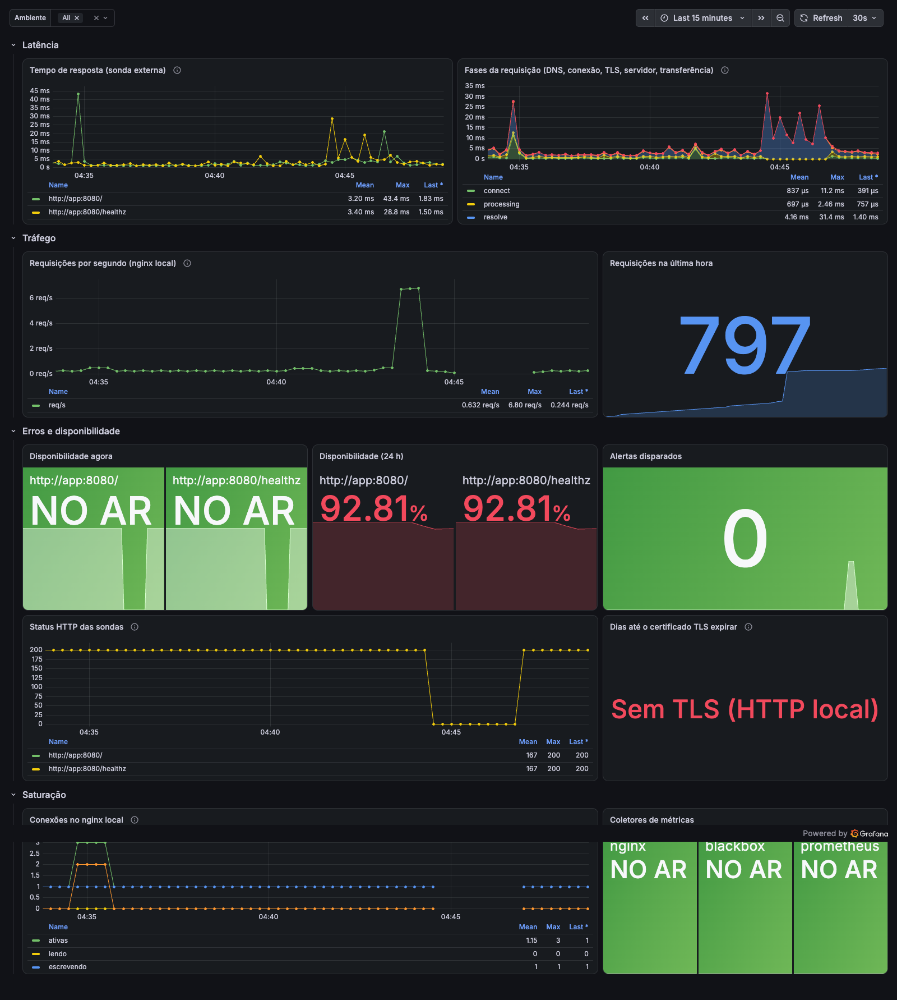

## 4. Notificações por e-mail do GitHub

O GitHub Code Scanning comentou os achados do Semgrep no PR #3:

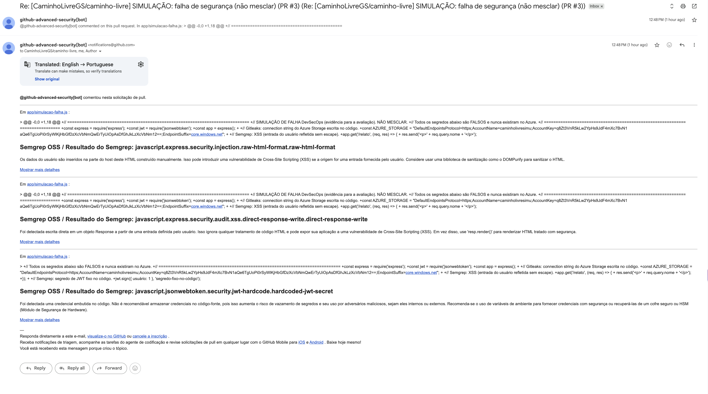

Notificações de falha do pipeline na simulação. No primeiro commit (`34ae35f`), o Trivy falhou porque um comentário na linha do `FROM` quebrou o Dockerfile, e não por causa de CVEs. Isso foi corrigido no commit `3719912`, que gerou a execução válida acima.

| Commit | Push | PR |
|---|---|---|
| `34ae35f` (Dockerfile com erro de sintaxe) | 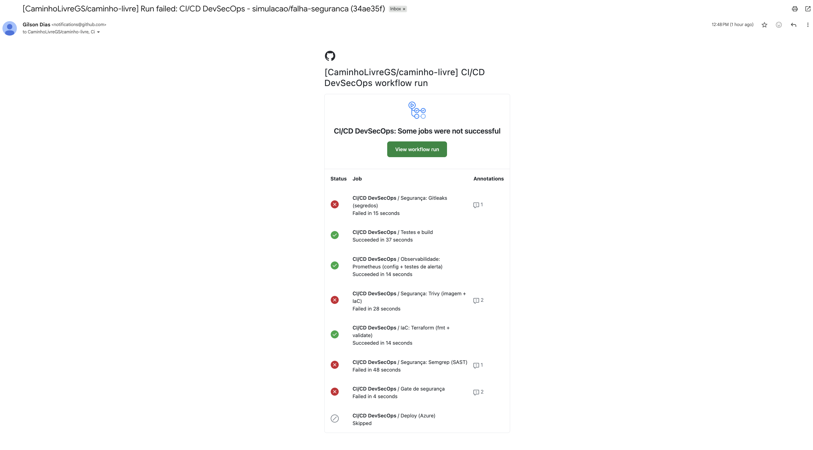 | 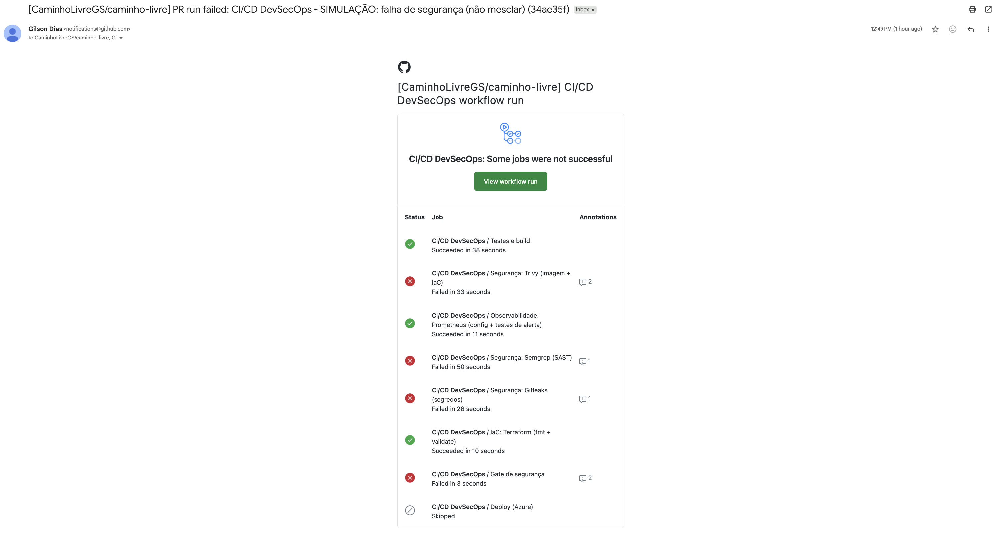 |
| `3719912` (execução válida) | 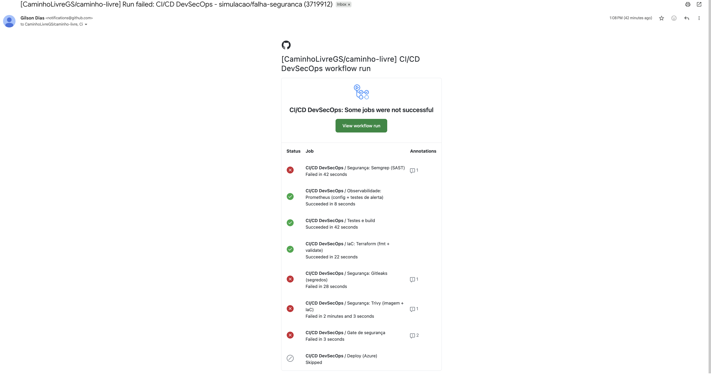 | 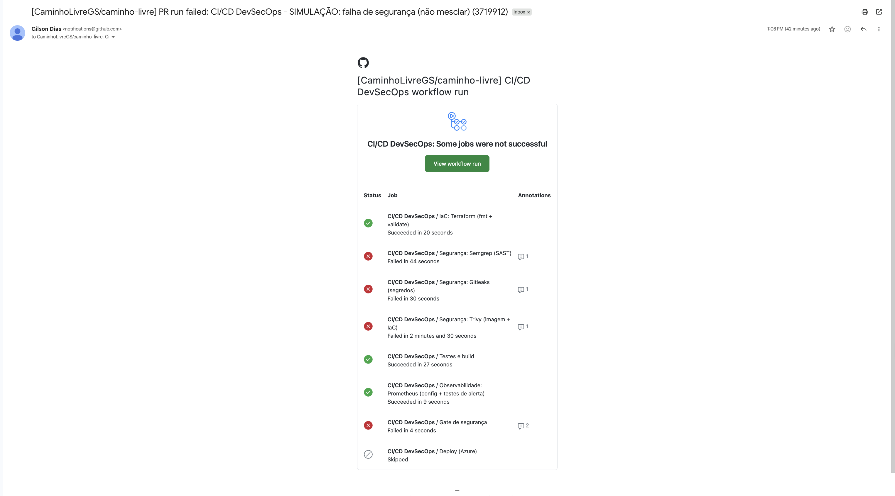 |
